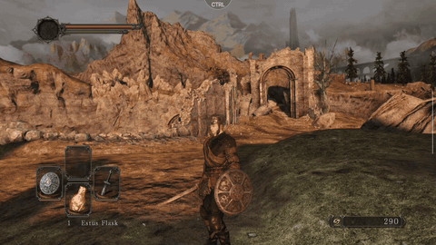
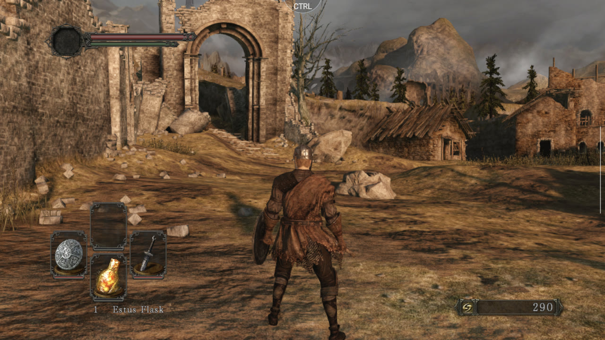
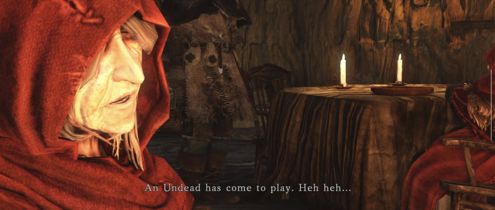
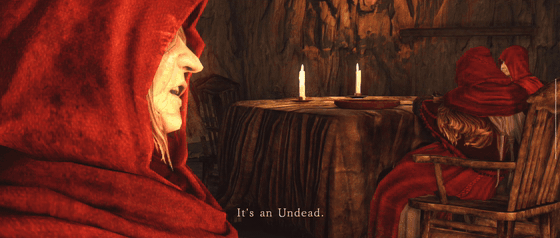
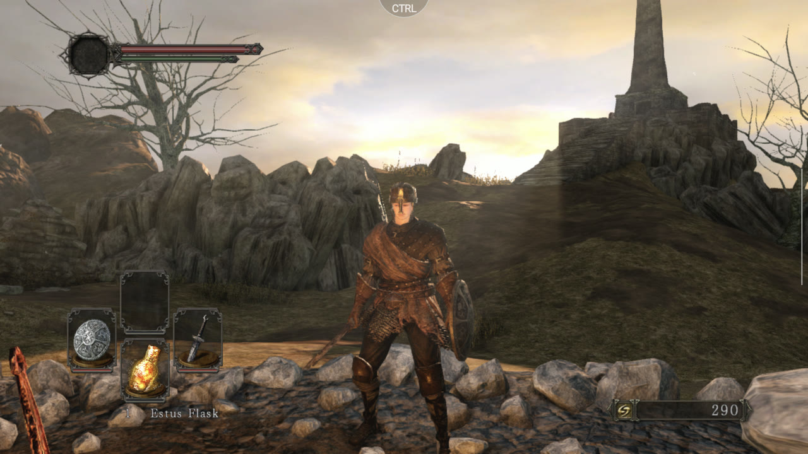
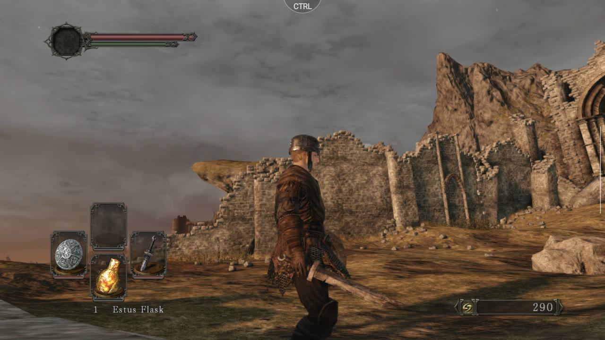

<p align="center"></p>

<h1 align="center">Dark Souls II: Scholar of the First Sin, native on Android</h1>

<p align="center">An unofficial native Android (arm64) port of the <b>Xbox 360</b> release, made by static recompilation.<br>
Bring your own copy of the game. No game files are included.</p>

<p align="center">

</p>

<p align="center">




</p>

<p align="center"><sub>Walking through Majula; the very first scene (Things Betwixt by moonlight) and Majula; the opening
cutscene in the witches' hut, rendered in real time. All captured on an AYN Thor at the 60 fps setting.</sub></p>

## What it is

The game's PowerPC code (`Default.xex` v0.0.0.22, title `465307E4`) is translated ahead of time to C++ with the
[ReXGlue SDK](https://github.com/rexglue/rexglue-sdk), compiled for arm64 and linked with the SDK's runtime (Xbox 360
kernel, XAM, audio) and a Xenia-derived Vulkan renderer. It runs natively; it is not an emulator of the CPU.

Developed and measured on an **AYN Thor** (Snapdragon 8 Gen 2, Adreno 740) with the Mesa **Turnip** Vulkan driver,
which the app ships and loads by itself.

## Status

- Playable from the start of the game through Majula, with saves, cutscenes, audio and the Scholar DLC data.
- **Performance (AYN Thor, 60 fps setting, a walk through Majula):** 60 fps average, 1% low 48-56 fps, no frame over
  26 ms; GPU ~13.6 ms per frame at ~640 MHz; about 7.7 W for the whole device, CPU ~79 C and GPU ~68 C.
- Frame-rate options: 30, 40 and 60 fps, and "Smoother 60" on 120 Hz panels.
- **Eco mode** (off by default): the 3D scene is shaded at reduced detail for less power and heat; HUD and text stay
  sharp. The picture is softer.
- Touch controls (or any game controller), a GPU driver manager, a performance overlay.
- Known issues: short frame-time dips while new areas stream in; see the issue list.

## Gallery

<p align="center">

</p>

<p align="center">
 
 
</p>

## What you need

- Your own **Dark Souls II: Scholar of the First Sin** for Xbox 360: **disc 1 and disc 2** (disc 2 carries
  Compatibility Pack 4 with the three Crown DLC areas; the game does not start without it).
- An arm64 Android device with Vulkan, Android 8 or newer (9 or newer for the bundled Turnip driver). Snapdragon
  (Adreno 6xx / 7xx) is the tested path; Mali and other GPUs use the system driver and are untested. About 8 GB free
  for the game files.

## Install

Releases are numbered 0.x while they are test builds; 1.0 comes once they have been played through on more devices.

1. **On the device**, download
   [`ds2-sotfs-android-arm64.apk`](https://github.com/Lazaer-YZY/ds2-sotfs-recomp/releases/latest/download/ds2-sotfs-android-arm64.apk)
   from the [latest release](https://github.com/Lazaer-YZY/ds2-sotfs-recomp/releases/latest) and open it to install
   (allow your browser or file manager to install apps when Android asks).
2. **Start it once.** It creates its folders, including `Android/data/com.ds2recomp.android/files/game/`, and with no
   game there yet it opens its game-folder page instead of the game. Close it.
3. **Copy the game** (about 6.7 GB) into the device's internal storage, in `Android/data/com.ds2recomp.android/files/`:

   | From your discs | To the device (`.../files/`) |
   |---|---|
   | everything on disc 1 (`Default.xex`, `GameData...`, `sound`, `movie`, ...) | `game/` (directly, no subfolder) |
   | the one file in disc 2's `content/0000000000000000/FFED2000/FFFFFFFF/` (the DLC package, 1.2 GB) | `dlc/` |

   To unpack a disc image on a PC: `python tools/android/xdvdfs.py <disc.iso> extract <folder>` (Python 3, no other
   dependencies). Windows Explorer can browse `Android/data` on most phones over USB; if it can't, use
   `adb push <folder>/. /sdcard/Android/data/com.ds2recomp.android/files/game/` (and the same for `dlc/`). The
   game-folder page can also pick a folder elsewhere on the device or import disc 1 straight from its ISO; the disc 2
   package always goes in `files/dlc/`.
4. **Start the game.** The first start installs the DLC package and loads the bundled shader cache at the title screen
   (a minute or two); later starts are quick. The game asks for its "offline" confirmations at boot; that is normal.

Snapdragon (Adreno) devices use the Turnip driver the app ships. Other GPUs (Mali, Xclipse, PowerVR) use the device's
own Vulkan driver: untested, and the game may not start. The **CTRL** button (top centre) has the frame rate (30 / 40 /
60), Eco mode, depth of field, the performance overlay and the touch layout. If the game crashes, the newest
`ds2*.log` in `Android/data/com.ds2recomp.android/files/logs/` helps in an issue.

You can also build the APK yourself (below).

## Building from source

Windows, Git Bash, from a path without spaces. The SDK's third-party sources are not in this repository: take them
from the ReXGlue SDK release this port is built on (v0.10.0), keeping this repository's own files in `sdk/thirdparty`:

```bash
git clone https://github.com/rexglue/rexglue-sdk.git ../rexglue-sdk-src
git -C ../rexglue-sdk-src checkout c94f5ebdcb3c9d1a460ca48e04f9758448f8d518   # Release v0.10.0
git -C ../rexglue-sdk-src submodule update --init --recursive
cp -rn ../rexglue-sdk-src/thirdparty/. sdk/thirdparty/
git submodule update --init thirdparty/libadrenotools
```

Then:

```bash
tools/android/extract_game.sh "<disc 1 .7z or .iso>" "<disc 2 .7z or .iso>"
tools/android/build_codegen_host.sh
tools/android/codegen.sh
tools/android/build_android.sh configure build stage apk
```

Toolchain: LLVM, CMake, Ninja, JDK 17, Android SDK and NDK r28.

## Credits

- **[XDASCATX/DS2_switch](https://github.com/XDASCATX/DS2_switch)** (GPL-3.0), a Nintendo Switch port of the same
  release: the game analysis, codegen configuration, the DLC installer and many game fixes, ported here by hand.
- **[ReXGlue SDK](https://github.com/rexglue/rexglue-sdk)** and **[Xenia](https://xenia.jp)**: the recompiler, runtime
  and renderer this builds on.
- **[Lost Odyssey Recomp](https://github.com/freefrank/LostOdysseyRecomp)**: the Android app shell this one grew from.
- **[Mesa Turnip](https://docs.mesa3d.org/drivers/freedreno.html)** and the
  [AdrenoTools](https://github.com/bylaws/libadrenotools) driver loader.
- Notes from [MajulaRecomp](https://github.com/hazevauks/MajulaRecomp) and
  [ds2scholar-nx](https://github.com/KostinKD/ds2scholar-nx).

## License and legal

GPL-3.0 (`LICENSE`), like DS2_switch; third-party code keeps its own licenses (`THIRD_PARTY_NOTICES.md`).
This is an unofficial fan project, not affiliated with or endorsed by FromSoftware, Bandai Namco or Microsoft.
Dark Souls is a trademark of FromSoftware, Inc. / Bandai Namco; Xbox 360 is a trademark of Microsoft. You must own the
game; this repository contains no game files, keys or generated code.
