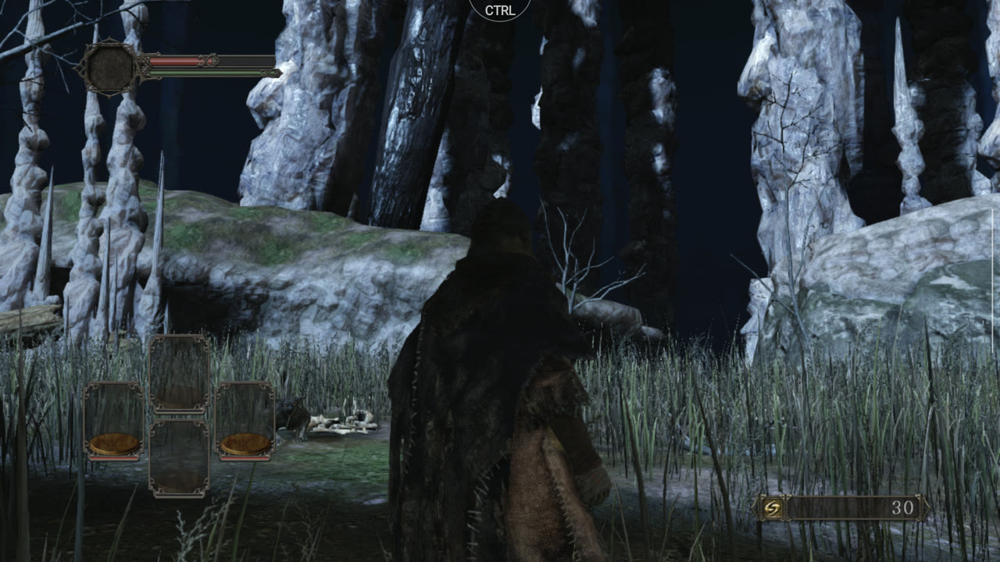
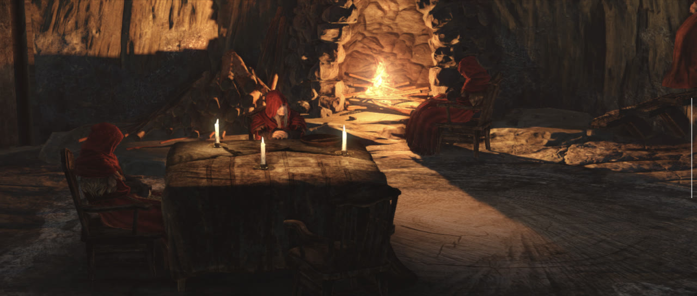
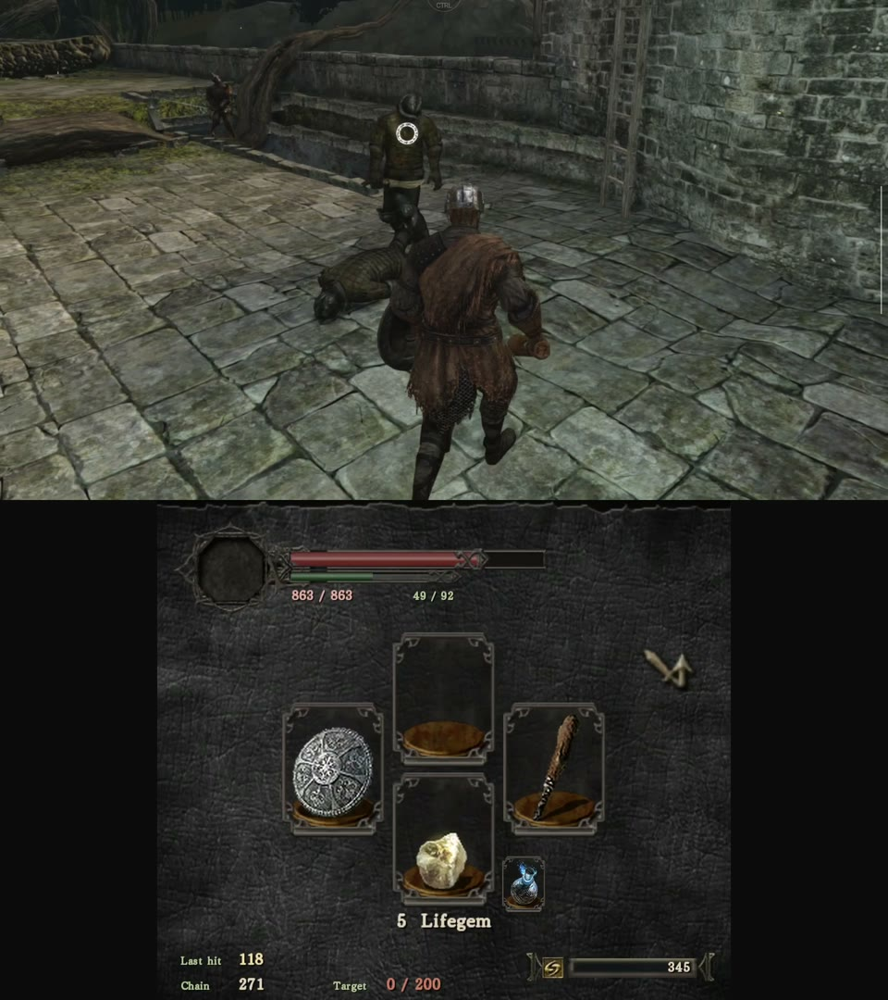
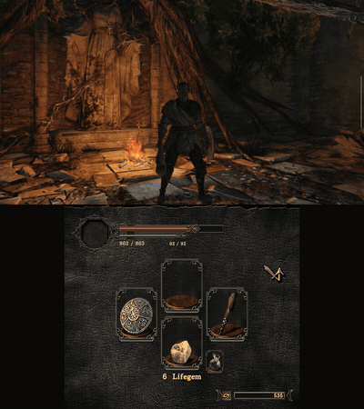
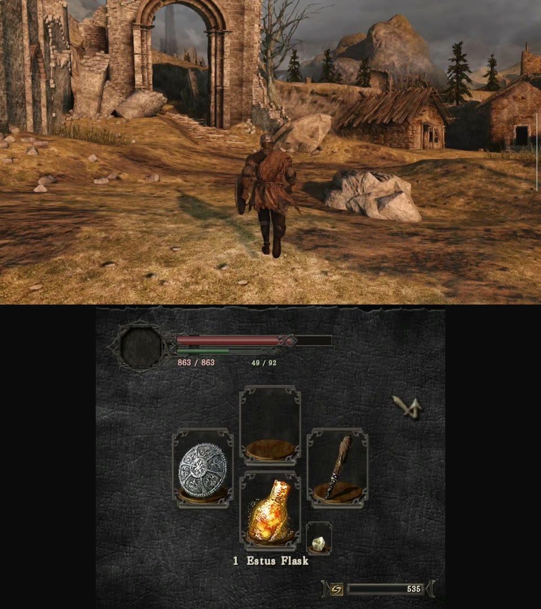
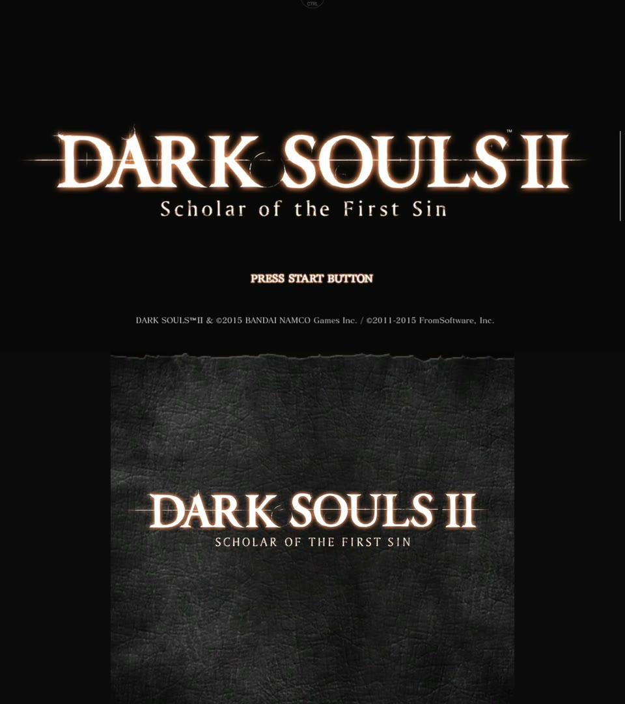
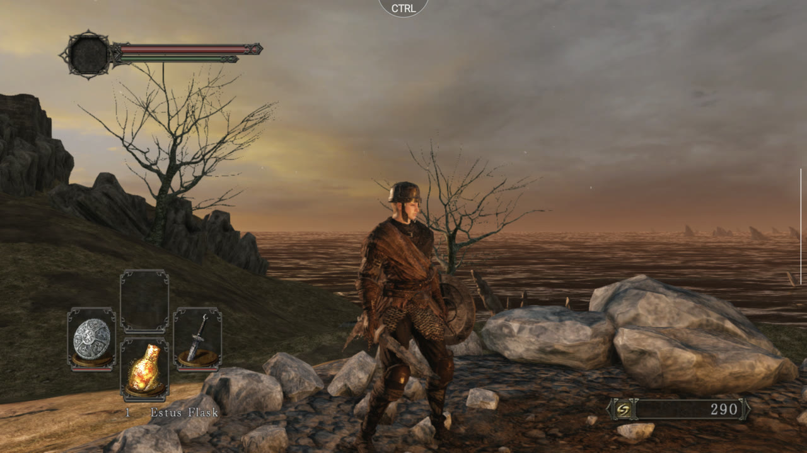
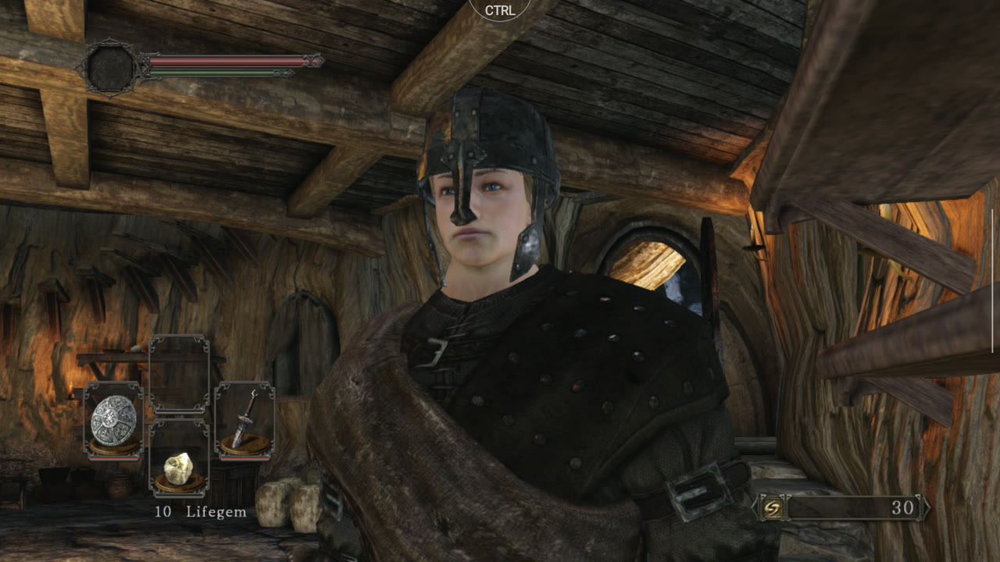

<p align="center"></p>

<h1 align="center">Dark Souls II: Scholar of the First Sin, native on Android</h1>

<p align="center">An unofficial native Android (arm64) port of the <b>Xbox 360</b> release, made by static recompilation.<br>
Bring your own copy of the game. No game files are included.<br>
On dual-screen handhelds such as the AYN Thor, the HUD can live on the second screen (<a href="#second-screen-ayn-thor-and-other-dual-screen-handhelds">see below</a>).</p>

<p align="center"><b>Beta:</b> playable, and looking for testers on more phones and handhelds (<a href="#help-test">help test</a>).</p>

<p align="center">

</p>

<p align="center">




</p>

<p align="center"><sub>Walking through Majula; the very first scene (Things Betwixt by moonlight) and Majula; the opening
cutscene in the witches' hut, rendered in real time. All captured on an AYN Thor at the 60 fps setting.</sub></p>

<p align="center">

</p>

<p align="center"><sub>Both screens of an AYN Thor: the game on top, its HUD (HP, stamina, equipment, effects, souls,
damage figures) on the second screen.</sub></p>

## What it is

The game's PowerPC code (`Default.xex` v0.0.0.22, title `465307E4`) is translated ahead of time to C++ with the
[ReXGlue SDK](https://github.com/rexglue/rexglue-sdk), compiled for arm64 and linked with the SDK's runtime (Xbox 360
kernel, XAM, audio) and a Xenia-derived Vulkan renderer. It runs natively; it is not an emulator of the CPU.

Developed and measured on an **AYN Thor** (Snapdragon 8 Gen 2, Adreno 740) with the Mesa **Turnip** Vulkan driver,
which the app ships and loads by itself; also played on a Samsung Galaxy S25 (Snapdragon 8 Elite).

## Status

- Playable from the start of the game through Majula, with saves, cutscenes, audio and the Scholar DLC data.
- **Performance (AYN Thor, 60 fps setting, a walk through Majula):** 60 fps average, 1% low 48-56 fps, no frame over
  26 ms; GPU ~13.6 ms per frame at ~640 MHz; about 7.7 W for the whole device, CPU ~79 C and GPU ~68 C.
- Frame-rate options: 30, 40 and 60 fps, and "Smoother 60" on 120 Hz panels. Render resolution 360p / 432p / 540p /
  720p / 1080p / 1440p and AMD FSR 1 upscaling.
- **Fill screen** for phones wider than 16:9, at every resolution: the game is drawn as wide as the screen, with more
  to see at the sides; the HUD and menus stay 16:9 in the middle and movies keep their shape.
- **Anti-aliasing** (FXAA) on the 3D scene only, so the HUD and text stay sharp.
- **Second screen HUD** on dual-screen handhelds such as the AYN Thor (see below).
- The game's own languages: English, French, German, Italian, Spanish, Brazilian Portuguese, Polish, Russian,
  Japanese, Korean and Traditional Chinese (CTRL, "Game language").
- Simple cheats in CTRL: infinite HP, infinite stamina, no equipment wear, and +10,000 souls.
- Touch controls with an editable layout and optional drag-to-look, or any game controller with its own button
  mapping; save backups to a folder of your choice; a GPU driver manager, GPU compatibility options, a performance
  overlay, and **Report a problem on GitHub** (logs and a prefilled issue form) straight from the phone.
- Known issues: short frame-time dips while new areas stream in; the heaviest views (the burning gate in the Forest
  of Fallen Giants) run at 55-58 fps on the Thor, whose GPU is then at its top clock. At 1080p, rare single frames
  of the wrong picture on the Adreno 830 (720p has none). On the Adreno 660, 720p crashes with the bundled driver;
  540p, its default, runs (#24). See the issue list.

## Second screen (AYN Thor and other dual-screen handhelds)

On a device with a second display, CTRL → **Second screen HUD** moves the HUD to the bottom screen: HP and stamina,
the four equipment slots, effect icons (tap one to see the equipped items behind it), souls and damage figures, drawn
with the game's own art from your discs. Without a character it shows the game's logo; menus keep it, warps and
loading screens dim it.

<p align="center">

</p>

<p align="center">


</p>

## Gallery

<p align="center">

</p>

<p align="center">
 
 
</p>

## What you need

- Your own **Dark Souls II: Scholar of the First Sin** for Xbox 360: **disc 1 and disc 2** (disc 2 carries
  Compatibility Pack 4 with the three Crown DLC areas; the game does not start without it).
- An arm64 Android device with Vulkan, Android 8 or newer (9 or newer for the bundled Turnip driver). Snapdragon
  (Adreno 7xx / 8xx) is the tested path; Adreno 6xx works from 0.5.1 (tested on an Adreno 640, players confirm the 650
  and 660). Mali GPUs use Arm's driver (drawn correctly from 0.5.4; slower Mali GPUs need 432p for 30 fps) or PanVK;
  other GPUs use the system driver and are untested. About 8 GB free
  for the game, plus room for one disc image (7.8 GB) while importing it.

## Install

The releases are a beta: playable, with rough edges on some GPUs. Each release is named after its main changes. 1.0
comes once the game has been played through on more devices.

1. **On the device**, download
   [`ds2-sotfs-android-arm64.apk`](https://github.com/Lazaer-YZY/ds2-sotfs-recomp/releases/latest/download/ds2-sotfs-android-arm64.apk)
   from the [latest release](https://github.com/Lazaer-YZY/ds2-sotfs-recomp/releases/latest) and open it to install
   (allow your browser or file manager to install apps when Android asks).
2. **Start it** (the icon is called **Dark Souls II**). With no game yet it opens its game-folder page, which lists
   both discs.
3. **Import the discs** from your own disc images (.iso) on the device (internal storage or SD card): tap
   **Import disc 1…** and pick the disc 1 ISO (the game, about 5.5 GB, is extracted), then **Import disc 2…** and pick
   the disc 2 ISO (only its DLC package, 1.2 GB, is copied). The page tells the discs apart by their contents and asks
   for the other one when a disc is done; each ISO can be deleted once it is imported.

   **Or copy from a PC** into the device's internal storage, in `Android/data/com.ds2recomp.android/files/`:

   | From your discs | To the device (`.../files/`) |
   |---|---|
   | everything on disc 1 (`Default.xex`, `GameData...`, `sound`, `movie`, ...) | `game/` (directly, no subfolder) |
   | the one file in disc 2's `content/0000000000000000/FFED2000/FFFFFFFF/` (the DLC package, 1.2 GB) | `dlc/` |

   To unpack a disc image on a PC: `python tools/android/xdvdfs.py <disc.iso> extract <folder>` (Python 3, no other
   dependencies). Windows Explorer can browse `Android/data` on most phones over USB; if it can't, use
   `adb push <folder>/. /sdcard/Android/data/com.ds2recomp.android/files/game/` (and the same for `dlc/`).
4. **Start the game.** The first start installs the DLC package and loads the bundled shader cache at the title screen
   (a minute or two; let it finish, as closing the app during it leaves the DLC half installed until the next start
   redoes it); later starts are quick. The game asks for its "offline" confirmations at boot; that is normal.

Snapdragon (Adreno) devices use the Turnip driver the app ships (on Adreno 8xx it renders straight to memory, as its
author recommends). Other GPUs (Mali, Xclipse, PowerVR) use the device's own Vulkan driver, or PanVK for Mali (GPU
driver page): little tested, and the game may not start. The **CTRL** button (top centre) opens the settings in sections:
Controls (touch controls and their layout, the CTRL button, controller buttons), Frame rate and performance (30 / 40 /
60 fps, the performance overlay), Image (render resolution, Fill screen, anti-aliasing, depth of field), Second screen,
Game (language, save backups, cheats) and Troubleshooting (GPU driver, logs, GPU compatibility options).
Settings marked * apply at the next start (CTRL offers to restart). If the game crashes, turn on **Debug logging** in
CTRL → Troubleshooting, reproduce it, then use **Report a problem on GitHub** (CTRL → Troubleshooting): it saves the
logs in your Download folder and opens an issue form with your phone, GPU and settings filled in; attach the logs file
there. (**Save logs for a bug report** makes the same zip without opening GitHub.)

You can also build the APK yourself (below).

## Help test

The more devices it is played on, the sooner it gets to 1.0. The quickest way to report is **CTRL → Troubleshooting →
Report a problem on GitHub**, which fills in your phone, GPU and settings and saves the logs to attach. Or open an
[issue](https://github.com/Lazaer-YZY/ds2-sotfs-recomp/issues) with:

- your phone or handheld and its GPU (Adreno, Mali, ...), and the GPU driver (GPU driver page);
- your CTRL settings: resolution, Fill screen, frame rate;
- how it runs: fps, where it stutters or crashes, anything that looks wrong (a screenshot helps);
- if something goes wrong, the zip from CTRL → **Save logs for a bug report**.

Reports that it simply works are useful too.

## Building from source

Windows, Git Bash, from a path without spaces. The SDK's third-party sources are not in this repository: take them
from the ReXGlue SDK release this port is built on (v0.10.0), keeping this repository's own files in `sdk/thirdparty`:

```bash
git clone https://github.com/rexglue/rexglue-sdk.git ../rexglue-sdk-src
git -C ../rexglue-sdk-src checkout c94f5ebdcb3c9d1a460ca48e04f9758448f8d518   # Release v0.10.0
git -C ../rexglue-sdk-src submodule update --init --recursive
cp -rn ../rexglue-sdk-src/thirdparty/. sdk/thirdparty/
git submodule update --init thirdparty/libadrenotools
```

Then:

```bash
tools/android/extract_game.sh "<disc 1 .7z or .iso>" "<disc 2 .7z or .iso>"
tools/android/build_codegen_host.sh
tools/android/codegen.sh
tools/android/build_android.sh configure build stage apk
```

Toolchain: LLVM, CMake, Ninja, JDK 17, Android SDK and NDK r28.

## Credits

- **[XDASCATX/DS2_switch](https://github.com/XDASCATX/DS2_switch)** (GPL-3.0), a Nintendo Switch port of the same
  release: the game analysis, codegen configuration, the DLC installer and many game fixes, ported here by hand.
- **[ReXGlue SDK](https://github.com/rexglue/rexglue-sdk)** and **[Xenia](https://xenia.jp)**: the recompiler, runtime
  and renderer this builds on.
- **[Lost Odyssey Recomp](https://github.com/freefrank/LostOdysseyRecomp)**: the Android app shell this one grew from.
- **[Mesa Turnip](https://docs.mesa3d.org/drivers/freedreno.html)** and the
  [AdrenoTools](https://github.com/bylaws/libadrenotools) driver loader.
- Notes from [MajulaRecomp](https://github.com/hazevauks/MajulaRecomp) and
  [ds2scholar-nx](https://github.com/KostinKD/ds2scholar-nx).

## License and legal

GPL-3.0 (`LICENSE`), like DS2_switch; third-party code keeps its own licenses (`THIRD_PARTY_NOTICES.md`).
This is an unofficial fan project, not affiliated with or endorsed by FromSoftware, Bandai Namco or Microsoft.
Dark Souls is a trademark of FromSoftware, Inc. / Bandai Namco; Xbox 360 is a trademark of Microsoft. You must own the
game; this repository contains no game files, keys or generated code.
